# Laboratorio 07 – Sistema de Atención Veterinaria

**Estudiante:** De La Cruz Zavala, Noemi · **Sección:** D
**Curso:** Desarrollo de Aplicaciones Web · **Semana 12 (Examen)**

Sistema de microservicios con **Java 17 + Spring Boot 3.3**, **Spring Data JPA** y **MySQL 8**.
Tres servicios independientes, cada uno con su propio puerto y su propia base de datos.

## 1. Arquitectura

```mermaid
flowchart LR
    C([Cliente / Postman])
    C -->|REST| P[servicio-propietario<br/>:8081]
    C -->|REST| M[servicio-mascota<br/>:8082]
    C -->|REST| Q[servicio-consulta<br/>:8083]
    M -.->|GET /api/propietarios/&#123;id&#125;<br/>valida que exista| P
    Q -.->|GET /api/mascotas/&#123;id&#125;<br/>valida que exista| M
    P --- DB1[(bd_propietario)]
    M --- DB2[(bd_mascota)]
    Q --- DB3[(bd_consulta)]
```



| Servicio | Responsabilidad | Puerto | Base de datos | Tabla |
|---|---|---|---|---|
| `servicio-propietario` | CRUD de propietarios (DNI único) | **8081** | `bd_propietario` | `propietarios` |
| `servicio-mascota` | CRUD de mascotas; `idPropietario` como referencia | **8082** | `bd_mascota` | `mascotas` |
| `servicio-consulta` | CRUD de consultas; `idMascota` como referencia | **8083** | `bd_consulta` | `consultas` |

- Las referencias entre servicios se hacen **solo por ID** (sin llaves foráneas entre bases ni tablas compartidas).
- Al crear/actualizar, `mascota` consulta a `propietario` y `consulta` consulta a `mascota` por HTTP para comprobar que el ID existe (`RestTemplate`, sin descubrimiento de servicios). Se puede desactivar con `VALIDAR_PROPIETARIO=false` / `VALIDAR_MASCOTA=false`.

## 2. Requisitos

- JDK 17 o superior
- Maven 3.9+ (o el Maven integrado de IntelliJ / Eclipse / VS Code)
- MySQL 8.x en `localhost:3306`
- Postman (para importar la colección)

## 3. Estructura del repositorio

```
DesarrolloAplicacionesWeb/
└── Semana12/
    ├── servicio-propietario/
    ├── servicio-mascota/
    ├── servicio-consulta/
    ├── script-bd.sql
    ├── Veterinaria.postman_collection.json
    ├── CONCLUSIONES.md
    ├── .gitignore
    └── README.md
```

Paquetes de cada microservicio (`com.veterinaria.<servicio>`):
`model` · `dto` · `repository` · `services` · `controller` · `exception` (+ `config` en mascota y consulta para el `RestTemplate`).

## 4. Base de datos

```bash
mysql -u root -p < script-bd.sql
```

Crea `bd_propietario`, `bd_mascota` y `bd_consulta` con sus tablas y datos de prueba
(3 propietarios, 4 mascotas, 4 consultas). Además, el perfil **dev** usa `ddl-auto: update` y
`createDatabaseIfNotExist=true`, por lo que también arranca si solo existe MySQL vacío.

## 5. Configuración y perfiles (`application.yml`)

El perfil activo se elige con `SPRING_PROFILES_ACTIVE` (por defecto **dev**).
**No hay credenciales reales en el repositorio**: se leen de variables de entorno.

| Valor | `dev` | `prod` |
|---|---|---|
| `spring.jpa.hibernate.ddl-auto` | `update` | `validate` |
| `spring.jpa.show-sql` | `true` | `false` |
| URL de BD | `jdbc:mysql://localhost:3306/<bd>` (por defecto) | `DB_URL` **obligatoria** |
| Usuario / clave | `DB_USERNAME` (def. `root`) / `DB_PASSWORD` (def. vacío) | `DB_USERNAME` / `DB_PASSWORD` **obligatorias** |
| Nivel de log | `DEBUG` para `com.veterinaria` | `WARN` raíz, `INFO` para `com.veterinaria` |
| Mensajes de error del servidor | por defecto | `include-message: never`, sin stacktrace |

Otras variables: `SERVER_PORT`, `PROPIETARIO_URL` (def. `http://localhost:8081`), `MASCOTA_URL` (def. `http://localhost:8082`).

## 6. Ejecución

Abrir **tres terminales** y levantar los servicios en este orden (propietario → mascota → consulta):

**Windows (PowerShell)**
```powershell
$env:DB_PASSWORD = "tu_clave_mysql"

cd Semana12\servicio-propietario ; mvn spring-boot:run
cd Semana12\servicio-mascota     ; mvn spring-boot:run
cd Semana12\servicio-consulta    ; mvn spring-boot:run
```

**Linux / macOS**
```bash
export DB_PASSWORD="tu_clave_mysql"

(cd Semana12/servicio-propietario && mvn spring-boot:run)
(cd Semana12/servicio-mascota     && mvn spring-boot:run)
(cd Semana12/servicio-consulta    && mvn spring-boot:run)
```

**Perfil prod**
```bash
export SPRING_PROFILES_ACTIVE=prod
export DB_URL="jdbc:mysql://localhost:3306/bd_propietario?useSSL=false&allowPublicKeyRetrieval=true&serverTimezone=America/Lima"
export DB_USERNAME="usuario_app"
export DB_PASSWORD="clave_app"
mvn spring-boot:run
```
(en prod las tablas deben existir: ejecutar antes `script-bd.sql`; `DB_URL` cambia por servicio: `bd_mascota`, `bd_consulta`.)

## 7. Endpoints

### Propietario – `http://localhost:8081`
| Método | Ruta | Descripción | Éxito |
|---|---|---|---|
| GET | `/api/propietarios` | Listar | 200 |
| GET | `/api/propietarios/{id}` | Obtener por ID | 200 |
| POST | `/api/propietarios` | Crear | 201 |
| PUT | `/api/propietarios/{id}` | Actualizar | 200 |
| DELETE | `/api/propietarios/{id}` | Eliminar | 204 |

### Mascota – `http://localhost:8082`
| Método | Ruta | Descripción | Éxito |
|---|---|---|---|
| GET | `/api/mascotas` | Listar | 200 |
| GET | `/api/mascotas/{id}` | Obtener por ID | 200 |
| GET | `/api/mascotas/propietario/{idPropietario}` | Mascotas de un propietario | 200 |
| POST | `/api/mascotas` | Crear | 201 |
| PUT | `/api/mascotas/{id}` | Actualizar | 200 |
| DELETE | `/api/mascotas/{id}` | Eliminar | 204 |

### Consulta – `http://localhost:8083`
| Método | Ruta | Descripción | Éxito |
|---|---|---|---|
| GET | `/api/consultas` | Listar | 200 |
| GET | `/api/consultas/{id}` | Obtener por ID | 200 |
| GET | `/api/consultas/mascota/{idMascota}` | Consultas de una mascota | 200 |
| POST | `/api/consultas` | Crear | 201 |
| PUT | `/api/consultas/{id}` | Actualizar | 200 |
| DELETE | `/api/consultas/{id}` | Eliminar | 204 |

### Ejemplos de cuerpo (JSON)

```json
// POST /api/propietarios
{ "nombres": "Noemi", "apellidos": "De La Cruz Zavala", "dni": "12345678", "telefono": "999888777", "email": "noemi@correo.com" }

// POST /api/mascotas
{ "nombre": "Toby", "especie": "Perro", "fechaNacimiento": "2021-05-10", "idPropietario": 1 }

// POST /api/consultas
{ "idMascota": 1, "fecha": "2025-06-15", "motivo": "Control general", "diagnostico": "Mascota en buen estado de salud", "costo": 50.00 }
```

## 8. Validaciones y manejo de errores

| Regla | Dónde |
|---|---|
| Campos obligatorios (`@NotBlank`, `@NotNull`) | DTO de los 3 servicios |
| DNI de 8 dígitos, email válido, teléfono 7–15 dígitos | `PropietarioRequest` |
| Fecha de nacimiento no futura | `MascotaRequest` |
| **Costo no negativo** (`@DecimalMin("0.00")`) | `ConsultaRequest` |
| DNI único | `PropietarioService` + índice único en BD |

Todas las respuestas de error tienen el mismo formato:

```json
{
  "timestamp": "2025-06-15T10:30:00",
  "status": 400,
  "error": "Bad Request",
  "message": "Hay campos inválidos en la solicitud",
  "path": "/api/consultas",
  "errores": { "costo": "El costo no puede ser negativo" }
}
```

| HTTP | Cuándo |
|---|---|
| 400 | Campos inválidos, JSON mal formado, fecha con formato incorrecto, ID no numérico |
| 404 | El recurso (propietario, mascota o consulta) no existe |
| 409 | DNI duplicado / violación de integridad |
| 422 | El `idPropietario` o `idMascota` enviado no existe en el otro servicio |
| 503 | El otro microservicio no está disponible |
| 500 | Error inesperado (mensaje genérico, detalle solo en el log) |

## 9. Pruebas con Postman

1. Importar `Veterinaria.postman_collection.json` (Import → File).
2. Con los 3 servicios levantados y la BD cargada, ejecutar con **Collection Runner** en orden:
   `01 Propietario` → `02 Mascota` → `03 Consulta` → `04 Casos de ERROR` → `05 Eliminación`.
3. Los IDs creados se guardan solos en variables (`propietarioId`, `mascotaId`, `consultaId`) y cada petición trae tests automáticos.

La prueba de aceptación (registrar propietario, mascota y consulta, y probar el CRUD) queda cubierta por las carpetas 01–03 y 05.

## 10. Subir a GitHub

```bash
git clone https://github.com/noemidelacruz-blip/DesarrolloAplicacionesWeb.git
cd DesarrolloAplicacionesWeb
# copiar aquí la carpeta Semana12/ completa
git add Semana12
git commit -m "Semana 12: Examen Lab 07 - Sistema de Atención Veterinaria (3 microservicios)"
git push origin main
```
(Si tu rama principal se llama `master`, usa `git push origin master`.)

## 11. Limitaciones conocidas (decisiones de diseño)

- No hay llaves foráneas entre bases: eliminar un propietario no elimina sus mascotas, y eliminar una mascota no elimina sus consultas (consistencia eventual, fuera del alcance de la guía).
- Si `servicio-propietario` está caído, crear mascotas devuelve 503 (o se puede desactivar la validación con `VALIDAR_PROPIETARIO=false`).
